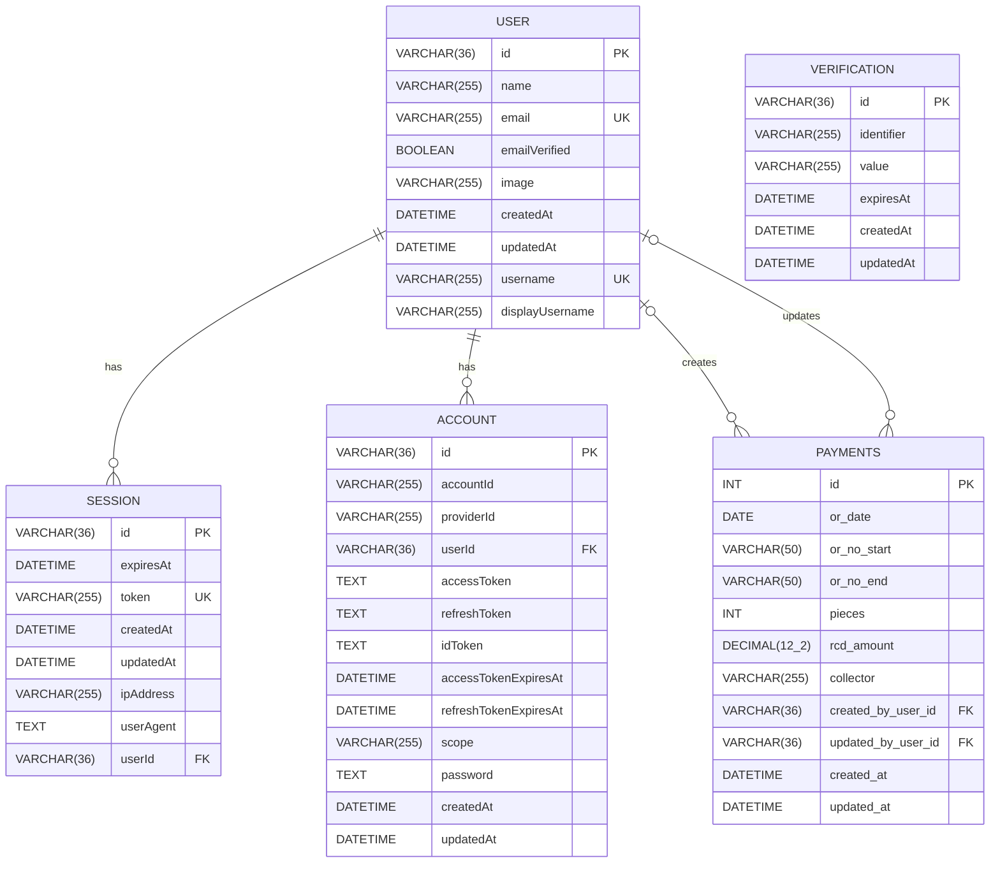
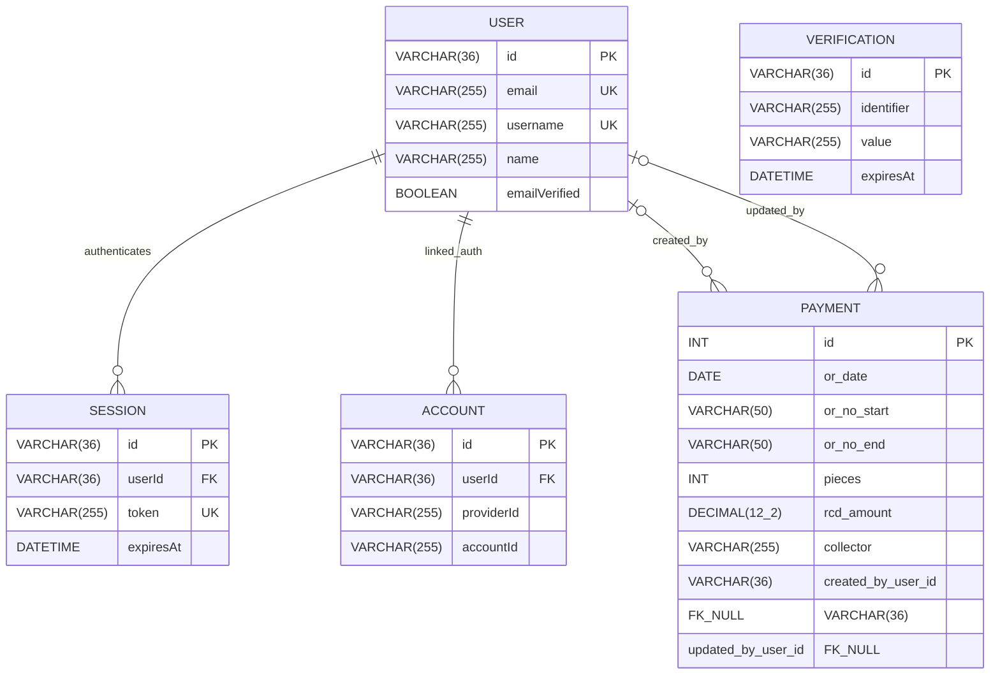

# Database ERD and EERD

These diagrams are based on the schema defined in `scripts/migrate.mjs` and the payment API behavior in the `app/api/payments` routes.

## ERD

## EERD

This enhanced version emphasizes participation and business roles used by the app:

- A `USER` can own many `SESSION` records.
- A `USER` can own many `ACCOUNT` records.
- A `PAYMENTS` record must have payment details, but its audit links are optional because `created_by_user_id` and `updated_by_user_id` are nullable and use `ON DELETE SET NULL`.
- `VERIFICATION` is currently standalone in the schema.

## Notes

- `SESSION.userId` and `ACCOUNT.userId` are mandatory foreign keys with `ON DELETE CASCADE`.
- `PAYMENTS.created_by_user_id` and `PAYMENTS.updated_by_user_id` are optional foreign keys with `ON DELETE SET NULL`.
- The app prevents overlapping O.R. ranges at the API layer, but that rule is not enforced by a database constraint.
